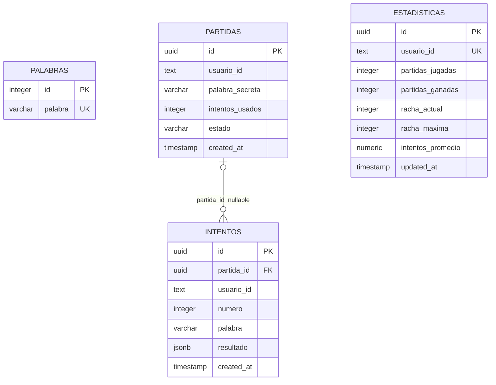

# FIN-01R — Matriz de aceptación

Fecha: 09/11/2026. Auditoría documental/técnica, sin nuevas pruebas ni despliegues. Corte: b330ae70caf08ac789786376ca5de0305ea4471f, rama codex/pg01-07-consolidation. FIN-01 no se cierra ni se actualiza el backlog.

## Fuentes y regla de interpretación

Fuente original del plan: `docs/analysis/tfg-plan-001/TFG-COMPLETION-PLAN.md:28-35`. Aunque el archivo conserva su rótulo de propuesta, la aprobación posterior está registrada por el propietario y `README.md`, sección Seguridad e historia. No se sustituye por un backlog inventado.

FIN-01 original exige DB PostgreSQL/Supabase local vacía que acepte migraciones, tablas/contratos coincidentes y secretos no versionados; pide conservar DDL, diagrama y log sanitizado. `docs/analysis/fin-01c/FIN-01C-MIGRATION-PLAN.md:54` sustituye el gate Supabase/PostgREST por API directa PG y mantiene confirmar supuestos. `docs/analysis/pg-01/PG-01-TRANSITION-DECISION.md:5-13` registra aprobación de PG16 nuevo, psycopg async y ausencia de migración de historial. Esto no autoriza afirmar equivalencia completa con Supabase.

No se encuentra el PDF académico original versionado en el repositorio (git ls-files '*.pdf' vacío). `TFG-COMPLIANCE-MATRIX.md:7` identifica el PDF previamente leído y su huella; sus citas son evidencia secundaria, no nueva verificación del PDF. No se convierten sus interpretaciones en requisitos oficiales nuevos. Reproducir esquema es un criterio técnico del plan; AKS/observabilidad pertenecen al proyecto académico completo.

## Matriz

| Criterio | Origen | Estado | Evidencia | Pendiente |
|---|---|---|---|---|
| Inventario sustentado fuera de MemoryDB | FIN-01 original | PASS | FIN-01B-RECONSTRUCTION-REVIEW.md §§1,4: metadatos aportados por propietario; baseline trazable, no deducido solo del doble | No afirmar dump remoto completo |
| DDL versionado y único | FIN-01 evidencias | PASS | supabase/migrations/20261108000100_initial_wordle.sql; FIN-01B-POSTGRES-VALIDATION.md; PUB-04 documenta CRLF/LF; PG-05/06/07 reutilizan misma fuente | Nada para baseline inicial |
| Base vacía acepta migración | FIN-01 aceptación literal | PASS | FIN-01B-POSTGRES-VALIDATION.md: dos DB nuevas, catálogo public vacío previo, seis ejecuciones SQL exit 0; PG-04 y CI PG-07 repiten bootstrap | No se reejecutó en FIN-01R |
| Tablas/tipos/defaults/constraints/índices del baseline coinciden | FIN-01 aceptación literal | PASS | schema_contracts.sql + FIN-01B: cuatro tablas, 23 columnas, siete constraints, seis índices; PG-06 catálogo real y PG-07 paso exitoso | Limitado al contrato aportado/implementado, no catálogo remoto íntegro |
| Ratificación de supuestos del contrato objetivo | FIN-01C-MIGRATION-PLAN.md:54 | PARTIAL | FIN-01B y supabase/README.md:66-70 explicitan typmod, secuencia y FK desconocidos; arquitectura PG nueva aprobada, backend compatible demostrado | Confirmar que los valores del baseline son el contrato aceptado para DB nueva; no requiere consulta Supabase |
| API directa PG y tipos HTTP compatibles | Gate revisado FIN-01C, PG-01 | PASS | PG-04-TEST-RESULTS.md C01-C22, once métodos reales con UUID/JSONB/numeric/timestamps, errores y secreto activo; PG-07 mismo adaptador ejecutado en CI | No se afirma comparación contra respuestas Supabase nunca capturadas |
| Integridad transaccional/concurrencia mínima | Decisión PG-03/04, soporte al gate | PASS | repository.py transaction/FOR UPDATE, PG-03-TEST-RESULTS.md y casos reales PG-04; rollback/carreras/estadísticas | Seguridad de jugador no demostrada por locks |
| Secretos fuera de fuentes versionadas | FIN-01 aceptación literal | PASS | .gitignore y plantillas vacías; auditorías PUB-02/PUB-04 staged sobre conjunto publicado; secretos PG-05 externos y PG-06 generados por stdin | Evidencia acotada de revisión, no garantía universal de historial/archivos privados; FIN-01R no lee valores |
| Resumen sanitizado de migración | FIN-01 evidencia | PASS | FIN-01B-POSTGRES-VALIDATION.md: entorno, DB vacías, resultados BEGIN/CREATE/COMMIT y checks; PG-07/PUB-05B resultados | Logs completos de Actions no descargables (403), no invalida el registro local |
| Diagrama de datos | FIN-01 evidencia | PASS | Diagrama derivado del DDL en este informe; FK nullable y usuario text sin tabla inventada | Informe local, no versionado; su publicación requiere autorización posterior |
| Entorno persistente Compose reproducible | PG-05, soporte F1 | PASS | README comandos + run_pg05_compose.py; PG-05-TEST-RESULTS.md arranque limpio/reinicio/down-up y snapshots completos | Linux helper revisado estáticamente, ejecución registrada Windows; no reproducido en esta auditoría |
| StatefulSet/PVC y reinicio local | PG-06, no requisito AKS | PASS | PG-06-TEST-RESULTS.md: pod reemplazado, mismo PVC/PV, filas idénticas y HTTP real | No implica CSI/AKS, backup ni destrucción de clúster |
| CI real del commit publicado | PG-07 y PUB-05B, soporte FIN-04 | PASS | Run 42692713269, mismo SHA/branch, completed/success reconfirmado por API en FIN-01R | Frontend tests y publicación de artefactos siguen FIN-04 |
| README refleja situación actual CI/publicación | Calidad documental de reproducción | PARTIAL | README:8-10,196 y sección CI conservan estado anterior: sin run y push solo main; PUB-05A/B y workflow ya acreditan codex/** y CI verde | Actualización mínima posterior, no modificación en auditoría ni requisito de nuevo runtime |
| Equivalencia exacta catálogo/RLS/roles Supabase | Alcance antiguo sustituido por PG-01 | NOT APPLICABLE | Base nueva aprobada; sin dependencia operativa Supabase ni traslado histórico; scripts prototype fuera de init | No reactivar servicio para cerrar FIN-01 |
| Diccionario completo/licenciado, semillas completas | FIN-02 | NOT APPLICABLE | Fixture cinco palabras, generador offline; FIN-02 del plan | Fuente definitiva/decisión de corpus demo en FIN-02 |
| Restore independiente con HTTP | FIN-02 y PG-08 propuesto | NOT APPLICABLE | PG-05 restaura DB auxiliar en mismo servidor sin owner/ACL; declara sus límites | Segundo destino/volumen, permisos y app sobre restore, fuera FIN-01 |
| Autenticación/autorización efectiva | FIN-03 | NOT APPLICABLE | SECURITY-NOTES y README: usuario_id cliente no verifica identidad | Decisión y pruebas negativas FIN-03 antes de exposición pública |
| GHCR, perfil AKS, Ingress y secretos operativos | FIN-04/05/06/07 | NOT APPLICABLE | Plan separa esos IDs; GHCR if:false, perfiles locales | No declarar funciones pendientes como validadas |
| Blue-Green/rollback/observabilidad/alertas/Azure/memoria | FIN-08 a FIN-22 | NOT APPLICABLE | Fases F3-F6 y dependencias del plan | No bloquean aceptación estructural FIN-01 |

PASS describe evidencia concreta en el alcance indicado, nunca mera existencia de un archivo. La ratificación pendiente es documental/de alcance, no fallo de SQL o CI.

## Diagrama derivado del DDL versionado

No hay FK palabras→partidas ni tabla usuarios en el baseline. usuario_id text no es identidad autenticada. El diagrama es documentación de estructura ya existente, no propuesta de cambios.

## Lecturas realizadas

Plan FIN completo (22 tareas), matriz académica secundaria, FIN-01A/B/C, todos los informes PG-01 a PG-07 y PUB-01/02/03/04/05/05A/05B/05C; README principal/Supabase, workflow, Dockerfiles, Compose base/memoria, scripts init/fixture, baseline/catalog tests, generador y manifests locales/PostgreSQL. Solo fuentes no sensibles; sin .env reales, kubeconfigs o backups. Las conclusiones distinguen registros históricos de comprobaciones nuevas.
