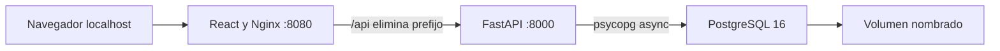

# PG-05 — Compose reproducible y PostgreSQL persistente

> PUB-02 (09/11/2026): rutas personales sustituidas por `%LOCALAPPDATA%` y/o `<evidencias-privadas>` cuando existían. Las evidencias siguen fuera de Git; los nombres/UID de recursos de prueba se conservan como trazabilidad, no como requisitos para otro clon. Resultados, fechas, versiones y conteos originales no se actualizan.

Fecha: 09/11/2026. Preparado para revisión. Se conserva codex/devops-04a1-hardening, HEAD a666b17680781a24889ea774778019995d3fca45, y todo el trabajo local PG-02/03/04. Sin commit/push, Supabase, Azure o inicio de PG-06. FIN-01 continúa pendiente.

## Resultado y arquitectura

Los tres servicios construidos con Compose arrancaron saludables y funcionaron de extremo a extremo desde Windows:



Solo Nginx publica un puerto en 127.0.0.1. FastAPI y PostgreSQL se unen únicamente a la red default internal:true, sin puertos publicados. Nginx añade una segunda red ingress bridge para el acceso desde Windows/Docker Desktop. No hay Ingress de Kubernetes: ingress es solo el nombre de una red Compose. El resolver Docker de Nginx existente resuelve backend y se ha probado después de recrear sus contenedores.

Base oficial postgres:16 disponible localmente, PostgreSQL 16.15. Backend usa DNS postgres:5432 y su rol wordle_app; conserva driver async, pool 0–4, transacción y contratos. PGSSLMODE=disable se limita a esta red interna local de demostración; no configura una conexión cloud. Backend depende de postgres service_healthy; frontend depende de backend service_healthy. No se añaden sleeps ni migraciones al arranque de FastAPI.

## Archivos PG-05

Modificados:

- compose.yaml: servicio postgres, volumen, scripts/baseline montados read-only, credenciales externas, healthcheck autenticado con rol app, dependencias y dos redes. Imágenes con prefijo del proyecto y puerto frontend parametrizable evitan pisar recursos de otros proyectos.
- compose.test.yaml: excluye postgres mediante perfil persistent inactivo; borra environment y depends_on del backend con !reset para conservar el modo memoria sin DB/credenciales. Se mantiene su red interna y acceso frontend. Requiere Compose con soporte de !reset (versiones actuales; probado v5.6.1).

Nuevos:

- docker/postgres/.env.example: plantilla sin contraseñas; puede versionarse con el .gitignore actual.
- docker/postgres/.gitattributes: solo los scripts .sh de esta carpeta con eol=lf, reproducibles en checkout Windows.
- docker/postgres/00-check-config.sh: valida credencial app y roles diferentes antes de cargar tablas.
- docker/postgres/20-demo-words.sql: seed de fixture mínima, identificada como demostración.
- docker/postgres/30-app-role.sh: rol app LOGIN separado del inicializador, USAGE de esquema/secuencia y SELECT/INSERT/UPDATE de tablas. psql recibe valores por entorno mediante getenv, no contraseñas en argumentos ni SQL versionado.
- docker/postgres/demo-words.txt: cinco palabras manuales controladas.
- backend/integration/run_pg05_compose.py: validador opt-in por etapas, proyecto/volumen nuevos, smoke real, persistencia, exportación/restauración y parada sin borrar volumen.
- Los tres documentos de esta carpeta.

No se modifica código funcional, frontend/Nginx, Dockerfiles, dependencias, pruebas anteriores, SQL original, Kubernetes, Terraform, Actions o documentos históricos. No se instala software global.

## Inicialización y persistencia

Se reutiliza sin cambiar supabase/migrations/20261108000100_initial_wordle.sql, SHA256 da743e629094da2b7d126f7889c5d1ca72e63a232844feadea3798254b19b0cb. La imagen oficial PostgreSQL ejecuta una vez los archivos ordenados de docker-entrypoint-initdb.d cuando PGDATA está vacío: validación, baseline, fixture y rol operativo. Una sola instancia realiza esta inicialización; los workers web no aplican DDL.

El healthcheck usa TCP 127.0.0.1 y autenticación del rol app para consultar palabras. El servidor temporal de inicialización no atiende TCP; backend no comienza por un pg_isready prematuro. Si fallan inicialización/credenciales, no se deben borrar o reinicializar datos para ocultar el error: conservar volumen, revisar la causa y obtener autorización para cualquier recuperación. Este mecanismo no es un gestor general de upgrades ni una migración recuperable tras cualquier interrupción.

El volumen nombrado postgres_data se prefija por proyecto. El validador genera nombre aleatorio y comprueba que el volumen previsto NO exista antes de construir/iniciar; posteriormente comprueba las etiquetas de procedencia. No se reutilizaron DB o volúmenes existentes. Segundo arranque: PostgreSQL conserva PG_VERSION/datos y omite init scripts; no reaplica baseline/seed ni cambia credenciales del rol. Cambiar el archivo de entorno después no rota las contraseñas ya guardadas en PG.

En la validación se compararon snapshots completos de las cuatro tablas antes/después de restart y de down/up, no solo sus recuentos. Resultado idéntico: 5 palabras, 4 partidas, 15 intentos y 3 estadísticas. Las partidas/estadísticas anteriores también coincidieron a través de /api tras recrear contenedores. Catálogo FIN-01B validado de nuevo; rol app no superusuario.

## Diccionario de demostración

No se encontró una fuente completa aprobada/licenciada. Se usa exclusivamente la fixture autorizada por la solicitud: CASAS, GATOS, NIÑOS, PERRO, SACAS. No se descarga una lista externa ni se presenta esta muestra como diccionario definitivo. Se utilizó build_seed del preparador FIN-01B, con validación A–Z/Ñ, cinco letras, normalización, deduplicación y ON CONFLICT DO NOTHING. Se ajustaron únicamente los comentarios del nuevo seed para identificarlo como fixture.

SHA256 de demo-words.txt: 5514ec50633a31f546b26021a8a67872f6d7a8c5058cf28d966bed3471736a64. La fuente completa sigue pendiente de aprobación; las palabras son datos de prueba, no historia Supabase.

## Ejecución reproducible sin mostrar secretos

Desde la raíz con Docker Desktop/Compose y el Python aislado existente. El validador genera dos contraseñas aleatorias fuera del repositorio; no lee .env existentes ni imprime valores:

```powershell
.\.venv\Scripts\python.exe -B backend/integration/run_pg05_compose.py start
# Copiar la ruta state.json que devuelve, sin abrir compose.env.
$state = 'RUTA_DEVUELTA/state.json'
.\.venv\Scripts\python.exe -B backend/integration/run_pg05_compose.py smoke --state $state
.\.venv\Scripts\python.exe -B backend/integration/run_pg05_compose.py backup_restore --state $state
.\.venv\Scripts\python.exe -B backend/integration/run_pg05_compose.py persist --state $state
.\.venv\Scripts\python.exe -B backend/integration/run_pg05_compose.py stop --state $state
```

start construye, crea un volumen NUEVO e inicia con --wait. smoke es API/TCP; la revisión de UI se realiza aparte. persist prueba restart y down/up conservando volumen, snapshots e información de inicialización. backup_restore conserva un dump fuera del repo y restaura en una base auxiliar nueva del mismo clúster; esa base auxiliar se elimina después de comparar tablas, sin tocar el origen. Repetir backup_restore con el mismo state requiere elegir otro destino de exportación: se usa creación exclusiva del fichero para no sobrescribir backups.

Para configuración manual, copiar docker/postgres/.env.example a una ubicación privada fuera del repo, definir dos contraseñas distintas y un proyecto nuevo, y usar siempre --env-file con ruta explícita. No ejecutar config sin --quiet con valores privados. Desde la raíz:

```text
docker compose --env-file <ruta-privada> --project-name <proyecto-propio> config --quiet
docker compose --env-file <ruta-privada> --project-name <proyecto-propio> build
docker compose --env-file <ruta-privada> --project-name <proyecto-propio> up --detach --wait
docker compose --env-file <ruta-privada> --project-name <proyecto-propio> ps
docker compose --env-file <ruta-privada> --project-name <proyecto-propio> port frontend 8080
docker compose --env-file <ruta-privada> --project-name <proyecto-propio> down
```

Antes de un proyecto nuevo, comprobar la ausencia de <proyecto>_postgres_data; si existe y hay dudas de procedencia, detenerse y pedir autorización. Para recuperar los datos existentes de esta validación, usar únicamente el proyecto/archivo privados documentados abajo, sin crear otro volumen ni aplicar SQL manualmente. WORDLE_HTTP_PORT=0 solicita puerto dinámico; el ejemplo manual usa 8080.

Validación de memoria sin secretos/DB:

```text
docker compose --env-file docker/postgres/.env.example -f compose.yaml -f compose.test.yaml config --quiet
```

El perfil persistent no se debe activar en ese modo. Su arranque no se ensayó en PG-05; se verificó configuración, ausencia de postgres/dependencia/credenciales y target memory-test. Las 55 pruebas offline siguieron verdes.

## Recursos conservados y cierre

Proyecto de validación: wordle-pg05-7325afa8cc. Contenedores y dos redes del proyecto eliminados mediante down sin -v. No hay servicios PG-05 ejecutándose ni consumo CPU/RAM de sus contenedores.

Se conserva expresamente el volumen **wordle-pg05-7325afa8cc_postgres_data**, con ~63872 KiB asignados en PGDATA durante la prueba (~62.4 MiB, puede variar). También imágenes locales del proyecto backend/frontend, tamaños reportados 314417730/92817687 bytes; comparten capas y no representan disco incremental exclusivo. No se purgaron imágenes/cachés o recursos ajenos.

Estado privado y credenciales generadas: %LOCALAPPDATA%/WordlePG05/wordle-pg05-7325afa8cc/state.json y compose.env en esa misma carpeta. No se han abierto ni impreso los valores de compose.env. Dump de demostración conservado: pg05-demo.dump, 7924 bytes, en la misma carpeta fuera del repo.

Para revisar este volumen conocido desde la raíz (las credenciales se consumen por Compose, no se muestran):

```powershell
$envFile = Join-Path $env:LOCALAPPDATA 'WordlePG05/wordle-pg05-7325afa8cc/compose.env'
docker compose --env-file $envFile --project-name wordle-pg05-7325afa8cc up --detach --wait
docker compose --env-file $envFile --project-name wordle-pg05-7325afa8cc port frontend 8080
# Al acabar, conservar de nuevo el volumen:
docker compose --env-file $envFile --project-name wordle-pg05-7325afa8cc down
```

Eliminación MANUAL futura, solo tras autorizar perder esos datos y detener su proyecto: `docker volume rm wordle-pg05-7325afa8cc_postgres_data`. No se ejecutó. Nunca usar down -v ni prune global para esta revisión.

## Criterios y continuación

Los doce criterios PG-05 tienen evidencia en [resultados](PG-05-TEST-RESULTS.md): tres servicios, volumen, init automático, psycopg Linux, proxy, juego, estadísticas, reinicio, segundo arranque no destructivo, regresión, reproducción y scope. La fixture no cierra el diccionario completo ni la autenticación; las credenciales por entorno son de demostración local, sin gestor de secretos cloud. El dump probado sin propietarios/ACL no demuestra recuperación completa de roles/permisos/aplicación en otro clúster; ampliar en PG-08.

Se recomienda revisar PG-05 antes de autorizar PG-06. No se modifica el backlog ni se declara FIN-01 completo.
